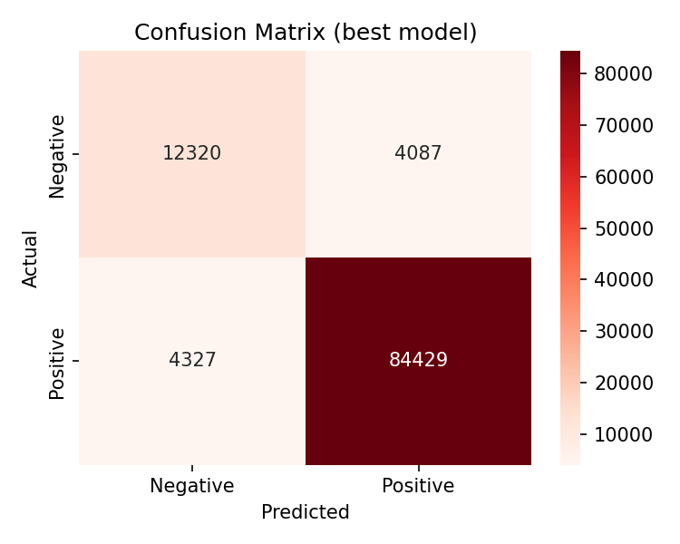
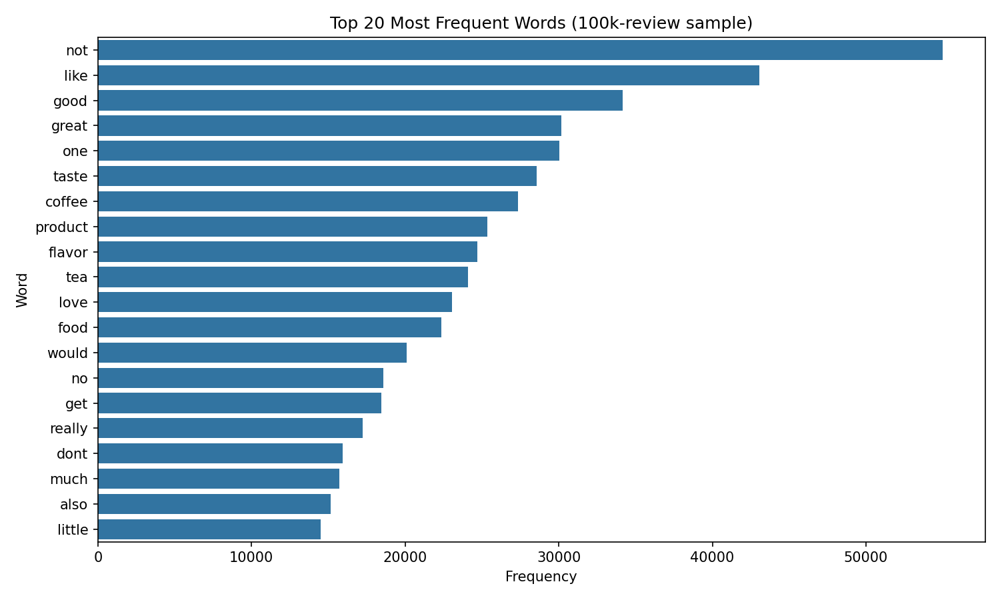

# Sentiment Analysis on Amazon Fine Food Reviews

Binary sentiment classifier (positive / negative) trained on about 525k Amazon food reviews, using NLTK preprocessing, Bag of Words and Naive Bayes.

Team project (4 students, TH Deggendorf, M.Eng. Applied AI for Digital Production Management). My part: [describe your own contribution, e.g. text preprocessing, feature extraction, model training and tuning].

## Data
Amazon Fine Food Reviews from Kaggle: https://www.kaggle.com/datasets/snap/amazon-fine-food-reviews

- 568,454 reviews loaded; 525,814 remain after removing neutral (3-star) reviews
- Score 4-5 = positive, score 1-2 = negative
- Imbalanced: about 84% positive, 16% negative

The dataset is not included in this repository. Download `Reviews.csv` and place it in a `data/` folder.

## Method
1. Remove HTML tags, lowercase, remove punctuation, remove English stop words (NLTK, keeping the negations "not", "no", "nor")
2. Vectorise with Bag of Words (also compared with TF-IDF)
3. Train Naive Bayes classifiers (Multinomial and Complement)
4. Stratified 80/20 train/test split (random seed 42), 420,651 training and 105,163 test reviews
5. Tune the smoothing parameter alpha with 5-fold cross-validation (macro F1) on a 100k sample of the training set; the test set is used only for final evaluation

## Results (held-out test set, 105,163 reviews)

| Model | Accuracy | Macro F1 | Negative recall | ROC-AUC |
|---|---|---|---|---|
| Always predict positive (baseline) | 0.844 | 0.46 | 0.00 | 0.50 |
| BoW + MultinomialNB (default) | 0.921 | 0.844 | 0.70 | 0.936 |
| TF-IDF + MultinomialNB | 0.858 | 0.549 | 0.10 | 0.931 |
| BoW + ComplementNB | 0.910 | 0.841 | 0.81 | 0.936 |
| **BoW + MultinomialNB (alpha=0.1, CV-tuned)** | **0.920** | **0.849** | **0.75** | **0.940** |

Notes:
- Because 84% of reviews are positive, accuracy alone is misleading: always predicting "positive" already scores 84.4%. Macro F1 and negative-class recall are more informative.
- Cross-validation scores of the best MultinomialNB (0.831) and ComplementNB (0.830) were within noise of each other. ComplementNB finds more negative reviews (recall 0.81) at lower precision (0.68 vs 0.74).
- TF-IDF has a similar ROC-AUC to Bag of Words but very low negative recall, which suggests the default decision threshold under class imbalance is the main problem (not tested).

## Most indicative words
- Negative: refund, worst, inedible, disappointing, disgusting, awful, rancid, terrible
- Positive: pleasantly, hooked, addicting, delish, yum, soothing, divine, perfect

## Limitations
- Bag of Words ignores word order and context. Words such as "skeptical" and "downside" appear among the positive indicators, probably from reviews like "I was skeptical at first, but...".
- 3-star reviews were removed, so the model does not handle neutral sentiment.
- Trained on food reviews only, so it may not transfer to other product types.
- Possible next steps: bigrams, decision-threshold tuning, class weights, transformer models (e.g. BERT).

## How to run
1. Install the requirements: `pip install -r requirements.txt`
2. Download `Reviews.csv` from the Kaggle link above and put it in `data/`
3. Open `sentiment_analysis.ipynb` (Jupyter or Google Colab) and run all cells

## Files
- `sentiment_analysis.ipynb`: full pipeline, evaluation and plots
- `results.csv`: model comparison table
- `images/`: plots used in this README
- `requirements.txt`: Python packages
